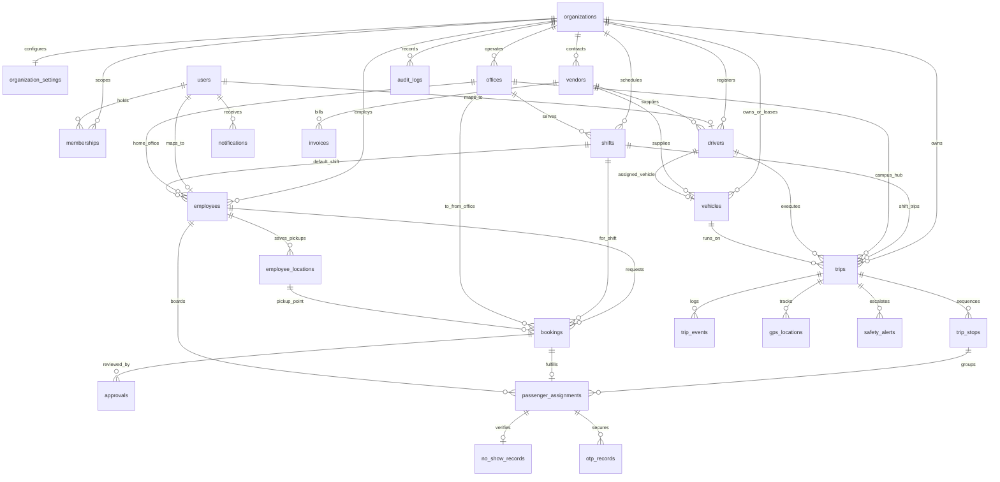
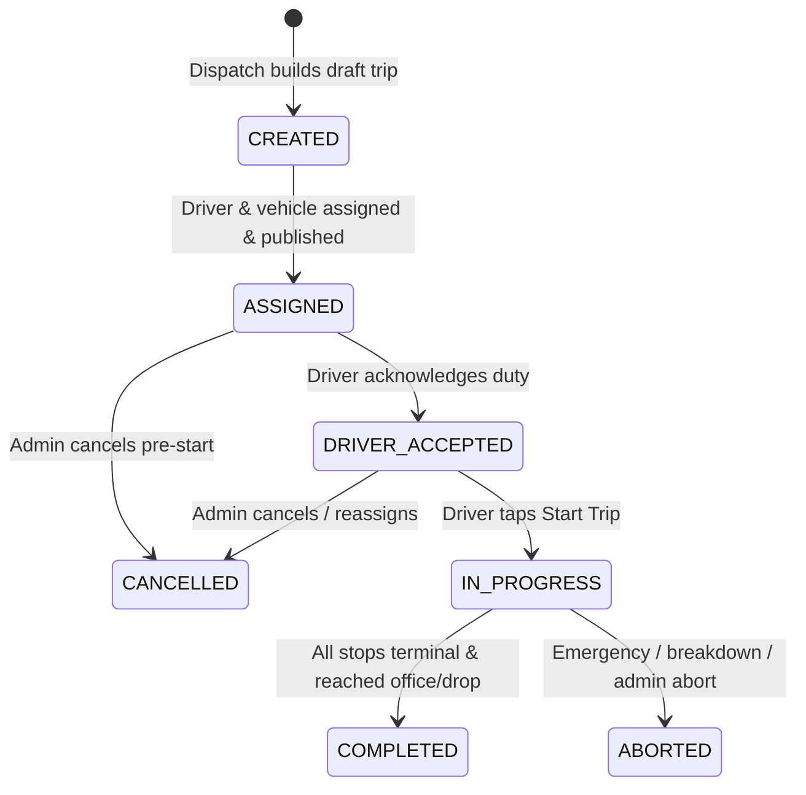
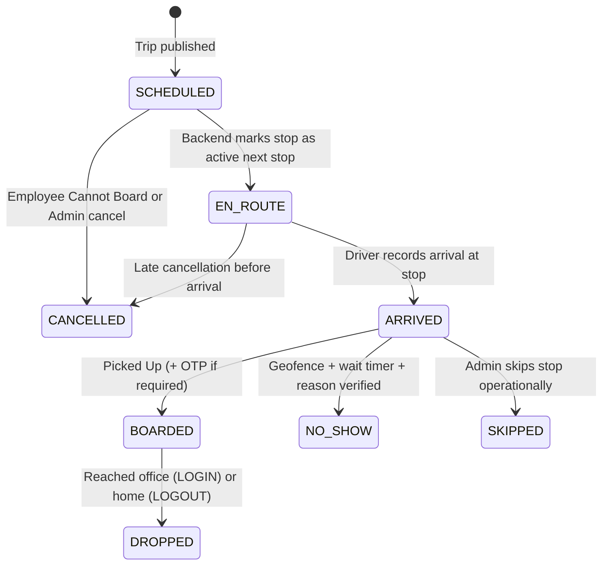

# Project Sol (SolTransit) — PostgreSQL + PostGIS Database Schema

**Deliverable:** Deliverable 3 (Database Entity Relationship Diagram & Relational Schema)  
**Database Engine:** PostgreSQL 16 + PostGIS 3.4  
**ORM / Migration Engine:** Drizzle ORM (`0.45.x`) + `drizzle-kit` SQL migrations (strictly no auto-sync in production)  
**Development Database:** `transport_dev` (localhost-bound)

---

## Deliverable 3 Metadata

- **What will be built:** A normalized multi-tenant relational + spatial database schema covering all 24 core tables plus `idempotency_keys` and `outbox_events` (`26` tables total), PostGIS `GEOGRAPHY(Point, 4326)` columns + GiST spatial indexes, enum constraints, and state-transition specs.
- **Why it is required:** Protects PostgreSQL as the permanent source of truth, enforces `organization_id` tenant isolation at the schema level, models `1 trip -> N stops -> M passenger_assignments` without coupling one passenger's no-show to trip failure, and preserves full audit & delay histories.
- **Dependencies:** `PRD.md`, `SYSTEM_ARCHITECTURE.md`, PostgreSQL 16 + PostGIS 3.4 Docker image.
- **Technologies:** PostgreSQL 16, PostGIS 3.4, Drizzle ORM (`pg-core`), `drizzle-kit`, SQL migrations.
- **Expected output:** Complete Mermaid ER Diagram, table-by-table column & constraint definitions, Trip & Passenger Assignment state machine diagrams, delay calculation spec, and indexing strategy.
- **Acceptance criteria:** All 24 tables from `master-prompt.md` §8 + `saved_locations` (`employee_locations`), `idempotency_keys`, and `outbox_events` execute cleanly via Drizzle SQL migrations against PostGIS; spatial queries (`ST_DWithin`) use GiST indexes; foreign keys and unique constraints pass integrity tests.
- **Relevant tests:** Migration up/verify tests, PostGIS geofence distance integration tests (`<= 150m`), tenant isolation query tests, idempotent event deduplication constraint tests.

---

## 1. Entity Relationship Diagram (Mermaid)

---

## 2. Core State Machines

### 2.1 Trip Status Model (`trips.status`)

### 2.2 Passenger Assignment Status Model (`passenger_assignments.status`)

A single `NO_SHOW` or `CANCELLED` updates **only that `passenger_assignment`**. The enclosing `trip` continues normally to the next pending stop.

---

## 3. Authoritative Delay Decomposition Model

Delay is NEVER stored as free text like `"4 mins late"`. The database persists UTC timestamps and coordinates, and computes integer seconds deterministically:

- `scheduled_arrival_at` (TIMESTAMPTZ)
- `actual_arrival_at` (TIMESTAMPTZ)
- `boarded_at` / `no_show_at` (TIMESTAMPTZ)
- `server_received_at` (TIMESTAMPTZ)
- Computed values:
  - `arrival_delay_seconds = EXTRACT(EPOCH FROM (actual_arrival_at - scheduled_arrival_at))::int`
    - `< 0` -> Early (e.g., `-180s` = `3m 00s early`)
    - `0` -> Exactly on time
    - `> 0` -> Late (e.g., `+240s` = `4m 00s late`)
  - `passenger_wait_seconds = EXTRACT(EPOCH FROM (COALESCE(boarded_at, no_show_at) - actual_arrival_at))::int`
- **Attribution Rule:** `arrival_delay_seconds` measures driver/traffic arrival punctuality; `passenger_wait_seconds` measures employee readiness wait time.

---

## 4. Complete Table Catalogue (26 Tables)

All tables use `UUID` primary keys (`defaultRandom()`), UTC `TIMESTAMPTZ` audit timestamps (`created_at`, `updated_at`), and `organization_id` foreign keys on all tenant-owned entities.

| # | Table Name | Key Columns & Spatial Types | Critical Indexes & Constraints |
| :-: | :--- | :--- | :--- |
| 1 | `organizations` | `id`, `name`, `slug` (unique), `status`, `country_code`, `timezone` (`Asia/Kolkata`) | `UNIQUE(slug)` |
| 2 | `organization_settings` | `id`, `organization_id` (PK/FK unique), `default_geofence_radius_m` (`150`), `no_show_wait_seconds` (`300`), `booking_cutoff_minutes` (`120`), `cancellation_cutoff_minutes` (`45`), `require_boarding_otp`, `require_deboarding_otp`, `gps_stale_threshold_seconds` (`60`), `gps_retention_days` (`90`), `currency_code` (`INR`) | `UNIQUE(organization_id)` |
| 3 | `users` | `id`, `email` (unique), `phone`, `full_name`, `password_hash` (nullable pre-Phase 8), `is_active` | `UNIQUE(email)` |
| 4 | `memberships` | `id`, `organization_id`, `user_id`, `role` (8-role enum), `vendor_id` (nullable), `office_id` (nullable), `is_active` | `UNIQUE(organization_id, user_id, role)` |
| 5 | `vendors` | `id`, `organization_id`, `name`, `code`, `contact_name`, `contact_phone`, `billing_rate_per_km_paise`, `billing_base_trip_paise`, `status` | `UNIQUE(organization_id, code)` |
| 6 | `offices` | `id`, `organization_id`, `name`, `code`, `address`, `latitude`, `longitude`, `location` (`GEOGRAPHY(Point, 4326)`), `geofence_radius_m` (`250`) | `GiST(location)`, `UNIQUE(organization_id, code)` |
| 7 | `shifts` | `id`, `organization_id`, `office_id`, `name`, `code`, `direction` (`LOGIN`/`LOGOUT`), `shift_time_local` (`HH:MM`), `days_of_week`, `is_active` | `UNIQUE(organization_id, office_id, code)` |
| 8 | `employees` | `id`, `organization_id`, `user_id`, `office_id`, `default_shift_id`, `employee_code`, `department`, `transport_eligible`, `emergency_contact_name`, `emergency_contact_phone` | `UNIQUE(organization_id, employee_code)`, `INDEX(organization_id, department)` |
| 9 | `employee_locations` *(saved_locations)* | `id`, `organization_id`, `employee_id`, `location_name`, `address`, `corridor_tag`, `latitude`, `longitude`, `location` (`GEOGRAPHY(Point, 4326)`), `google_place_id`, `original_maps_url`, `geofence_radius_m` (`150`), `is_default`, `verified` | `GiST(location)`, `INDEX(organization_id, employee_id)` |
| 10 | `vehicles` | `id`, `organization_id`, `vendor_id`, `registration_no`, `vehicle_type` (`SEDAN`/`SUV`/`TEMPO`/`EV`), `seating_capacity`, `availability_status`, `insurance_expires_at`, `permit_expires_at`, `fitness_expires_at` | `UNIQUE(organization_id, registration_no)` |
| 11 | `drivers` | `id`, `organization_id`, `user_id`, `vendor_id`, `assigned_vehicle_id`, `driver_code`, `license_no`, `license_expires_at`, `availability_status`, `is_suspended` | `UNIQUE(organization_id, driver_code)`, `INDEX(organization_id, availability_status)` |
| 12 | `bookings` | `id`, `organization_id`, `employee_id`, `shift_id`, `office_id`, `pickup_location_id`, `travel_date` (`DATE`), `direction` (`LOGIN`/`LOGOUT`), `scheduled_pickup_at`, `status` (`PENDING_APPROVAL`/`APPROVED`/`REJECTED`/`DISPATCHED`/`CANCELLED`), `cancellation_reason`, `cancelled_at` | `UNIQUE(organization_id, employee_id, travel_date, shift_id, direction)` (when active), `INDEX(organization_id, travel_date, status)` |
| 13 | `approvals` | `id`, `organization_id`, `booking_id`, `approver_user_id`, `decision` (`APPROVED`/`REJECTED`), `remarks`, `decided_at` | `INDEX(organization_id, booking_id)` |
| 14 | `trips` | `id`, `organization_id`, `office_id`, `shift_id`, `driver_id`, `vehicle_id`, `vendor_id`, `travel_date` (`DATE`), `direction` (`LOGIN`/`LOGOUT`), `status` (`7-state enum`), `current_stop_sequence`, `planned_start_at`, `actual_start_at`, `completed_at`, `aborted_at`, `abort_reason` | `INDEX(organization_id, travel_date, status)`, `INDEX(driver_id, status)` |
| 15 | `trip_stops` | `id`, `organization_id`, `trip_id`, `sequence_no`, `stop_type` (`PICKUP`/`DROP`/`OFFICE`), `location_name`, `address`, `latitude`, `longitude`, `location` (`GEOGRAPHY(Point, 4326)`), `geofence_radius_m`, `scheduled_arrival_at`, `actual_arrival_at`, `completed_at`, `status` (`PENDING`/`ACTIVE`/`ARRIVED`/`COMPLETED`/`SKIPPED`) | `UNIQUE(trip_id, sequence_no)`, `GiST(location)` |
| 16 | `passenger_assignments` | `id`, `organization_id`, `trip_id`, `trip_stop_id`, `booking_id`, `employee_id`, `status` (`8-state enum`), `scheduled_pickup_at`, `driver_arrived_at`, `boarded_at`, `dropped_at`, `no_show_at`, `arrival_delay_seconds`, `passenger_wait_seconds`, `running_late_eta_minutes`, `running_late_reported_at`, `safe_reach_confirmed_at`, `cancellation_reason` | `UNIQUE(booking_id)`, `INDEX(trip_id, status)`, `INDEX(employee_id, status)` |
| 17 | `trip_events` | `id`, `organization_id`, `trip_id`, `trip_stop_id`, `passenger_assignment_id`, `actor_user_id`, `actor_role`, `event_type`, `client_event_id` (UUID), `occurred_at_client`, `server_received_at`, `latitude`, `longitude`, `gps_accuracy_m`, `payload_json` | `UNIQUE(organization_id, client_event_id)`, `INDEX(trip_id, server_received_at)` |
| 18 | `gps_locations` | `id`, `organization_id`, `trip_id`, `driver_id`, `latitude`, `longitude`, `location` (`GEOGRAPHY(Point, 4326)`), `accuracy_m`, `speed_mps`, `heading_deg`, `recorded_at`, `server_received_at`, `client_ping_id` | `UNIQUE(trip_id, client_ping_id)`, `INDEX(trip_id, recorded_at DESC)`, `GiST(location)` |
| 19 | `no_show_records` | `id`, `organization_id`, `trip_id`, `trip_stop_id`, `passenger_assignment_id`, `employee_id`, `driver_id`, `reason_code`, `driver_notes`, `driver_arrived_at`, `wait_started_at`, `marked_at`, `waited_seconds`, `distance_from_stop_m`, `geofence_verified`, `gps_accuracy_m`, `latitude`, `longitude`, `sync_status` (`VERIFIED`/`PENDING_RECONCILE`), `appeal_status` (`NONE`/`APPEALED`/`OVERTURNED`/`UPHELD`), `appeal_resolved_by`, `appeal_resolution_note` | `UNIQUE(passenger_assignment_id)`, `INDEX(organization_id, appeal_status)` |
| 20 | `otp_records` | `id`, `organization_id`, `passenger_assignment_id`, `otp_type` (`BOARDING`/`DEBOARDING`), `otp_code_hash`, `expires_at`, `verified_at`, `attempts` | `INDEX(passenger_assignment_id, otp_type)` |
| 21 | `notifications` | `id`, `organization_id`, `recipient_user_id`, `channel` (`IN_APP`/`PUSH`), `category`, `title`, `body`, `metadata_json`, `read_at`, `sent_at` | `INDEX(recipient_user_id, read_at, created_at DESC)` |
| 22 | `safety_alerts` | `id`, `organization_id`, `trip_id`, `employee_id`, `driver_id`, `alert_type` (`SOS`/`ROUTE_DEVIATION`/`LONG_STOPPAGE`/`SAFE_REACH_OVERDUE`), `severity` (`MEDIUM`/`HIGH`/`CRITICAL`), `status` (`OPEN`/`ACKNOWLEDGED`/`RESOLVED`), `latitude`, `longitude`, `accuracy_m`, `notes`, `acknowledged_by`, `resolved_by`, `resolved_at` | `INDEX(organization_id, status, severity)` |
| 23 | `audit_logs` | `id`, `organization_id`, `actor_user_id`, `actor_role`, `action`, `entity_type`, `entity_id`, `reason`, `before_json`, `after_json`, `correlation_id`, `created_at` | `INDEX(organization_id, entity_type, entity_id)`, `INDEX(organization_id, created_at DESC)` |
| 24 | `invoices` | `id`, `organization_id`, `vendor_id`, `invoice_number`, `period_start`, `period_end`, `total_trips`, `total_distance_km`, `subtotal_paise`, `tax_paise`, `total_paise`, `currency` (`INR`), `status` (`DRAFT`/`ISSUED`/`RECONCILED`/`DISPUTED`) | `UNIQUE(organization_id, invoice_number)` |
| 25 | `idempotency_keys` *(supplementary)* | `id`, `organization_id`, `idempotency_key`, `request_method`, `request_path`, `request_hash`, `status_code`, `response_json`, `expires_at` | `UNIQUE(organization_id, idempotency_key)` |
| 26 | `outbox_events` *(supplementary)* | `id`, `organization_id`, `topic`, `aggregate_type`, `aggregate_id`, `payload_json`, `created_at`, `published_at`, `retry_count`, `last_error` | `INDEX(published_at, created_at)` (partial index `WHERE published_at IS NULL`) |

