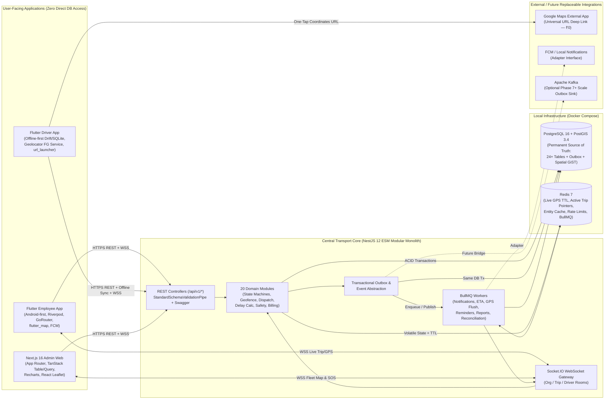
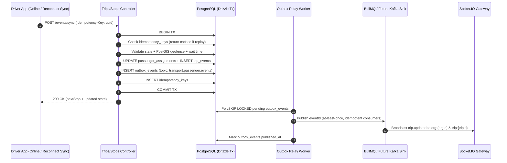

# Project Sol (SolTransit) — System Architecture & Backend Module Breakdown

**Deliverables Covered:**
- **Deliverable 2:** System Architecture Diagram
- **Deliverable 4:** Detailed Backend Module Breakdown (NestJS 12 ESM Modular Monolith)

---

## Deliverable 2 & 4 Metadata

- **What will be built:** The unified **Central Transport Core** (`backend/`, NestJS 12 ESM modular monolith) connecting three client applications (`apps/employee_app`, `apps/driver_app`, `web/`), PostgreSQL 16 + PostGIS 3.4, Redis 7, BullMQ background workers, Socket.IO real-time gateways, and a Transactional Outbox event bus extensible to Apache Kafka.
- **Why it is required:** Enforces a single source of business logic and state validation, isolates domain modules cleanly (`20` business modules + `9` infrastructure modules), eliminates client/server drift, and ensures zero critical data loss across Redis restarts or offline mobile periods.
- **Dependencies:** `PRD.md`, `DATABASE_SCHEMA.md`, `DOCKER_SETUP.md`, confirmed NestJS 12 ESM + Drizzle + Vitest stack.
- **Technologies:** NestJS 12.x (`@nestjs/common`, `core`, `platform-express`, `config`, `swagger`, `websockets`, `platform-socket.io`, `bullmq`), TypeScript 6.0 ESM, Drizzle ORM 0.45 + `pg`, `ioredis` 6, BullMQ 6, Zod 4 (`StandardSchemaValidationPipe`), Vitest 4, `oxlint`.
- **Expected output:** End-to-end architectural blueprint, Mermaid topology and data-flow diagrams, Redis keyspace design, BullMQ queue definitions, Kafka-ready outbox abstraction, and strict module dependency rules.
- **Acceptance criteria:** All 20 domain modules and 9 infrastructure directories from `master-prompt.md` §6 exist with zero circular imports; clients never connect directly to Postgres/Redis; business decisions execute exclusively inside backend services.
- **Relevant tests:** Module DI wiring tests, circular-dependency checks, health readiness tests (`Postgres + PostGIS + Redis`), transactional outbox dispatch tests, and WebSocket room isolation tests.

---

## 1. High-Level System Architecture (Deliverable 2)

---

## 2. Architectural Boundary Rules

1. **Central Transport Core Owns All Decisions:** Next.js and Flutter NEVER compute next pickup stop, validate geofence no-show eligibility, mutate trip statuses locally as authoritative, or generate invoice totals independently.
2. **PostgreSQL + PostGIS is Permanent Truth:** Every booking, approval, trip stop, passenger state transition, `trip_events` audit entry, `no_show_records`, `safety_alerts`, and `outbox_events` commits to PostgreSQL before HTTP `200/201/202` success is returned.
3. **Redis is Volatile Acceleration & Queue Transport Only:**
   - Never store unpersisted trip completions, pick-ups, or no-shows only in Redis.
   - If Redis restarts cleanly or flushes, active trips reconstruct from PostgreSQL (`trips.status = 'IN_PROGRESS'`).
   - Live GPS keys enforce explicit TTL (`180s` hard TTL; `60s` application staleness threshold) and carry `recorded_at`, `server_received_at`, and `accuracy_m`.
4. **Module Isolation & Layering Rule:** Each module under `backend/src/modules/<name>/` follows:
   - `<name>.controller.ts` (HTTP boundary, `@ApiTags`, `StandardSchemaValidationPipe` DTO validation, RBAC role decorator)
   - `<name>.service.ts` (Pure business rules, state validation, transaction coordination)
   - `<name>.repository.ts` (Drizzle ORM / PostGIS SQL queries scoped strictly by `organizationId`)
   - `dto/` & `schemas/` (Zod v4 schemas & Swagger types)
   - `<name>.spec.ts` (Vitest unit & contract tests)
   Controllers never query Drizzle directly; repositories never emit WebSocket or BullMQ side effects.

---

## 3. Redis Keyspace & BullMQ Queue Architecture

### 3.1 Canonical Redis Key Schema

| Key Pattern | Value Type | TTL / Expiry Policy | Owner Module | Purpose |
| :--- | :--- | :--- | :--- | :--- |
| `transport:driver:{driverId}:location` | Hash / JSON (`lat, lng, accuracy_m, speed_mps, heading, recorded_at, server_received_at, trip_id`) | `EX 180` (3 min hard expiry; `>60s` rendered Stale) | `tracking` | Latest driver GPS ping for live map & employee ETA |
| `transport:driver:{driverId}:active-trip` | String (`tripId`) | `EX 43200` (12h; deleted on trip complete/abort) | `trips` | Fast lookup for incoming GPS pings |
| `transport:trip:{tripId}:live` | JSON snapshot (`status, current_stop_id, current_stop_seq, next_stop_id, updated_at`) | `EX 43200` (rebuilt from PG on cache miss) | `trips` | Low-latency trip header & WS fan-out snapshot |
| `transport:trip:{tripId}:current-stop` | JSON (`stop_id, seq, eta_at, passengers_pending`) | `EX 43200` | `stops` | Instant next-stop resolution check |
| `transport:cache:employee:{employeeId}` | JSON profile + default location summary | `EX 900` (invalidated on mutation) | `employees` | Reduce DB reads during booking/dispatch |
| `transport:cache:vehicle:{vehicleId}` | JSON reg, capacity, status | `EX 900` (invalidated on mutation) | `vehicles` | Dispatch picker acceleration |
| `transport:idem:{orgId}:{key}` | JSON status + cached HTTP response | `EX 86400` (24h fast path backed by PG `idempotency_keys`) | `common` | Prevent duplicate driver button/offline replay execution |
| `transport:ratelimit:{scope}:{id}` | Counter | Windowed (`EX 60`) | `common` | Throttle high-frequency GPS / SOS / OTP endpoints |

### 3.2 BullMQ Queues (`backend/src/infrastructure/queue/`)

| Queue Name | Job Types | Retry / Backoff | Idempotency Key Strategy |
| :--- | :--- | :--- | :--- |
| `notifications` | `send-push`, `dispatch-in-app`, `sos-escalate` | `5` attempts, exponential `2s` | `notif:{outboxEventId}` |
| `trip-reminders` | `pre-shift-reminder`, `cab-approaching` | `3` attempts, `5s` | `reminder:{tripId}:{stopId}:{type}` |
| `eta-calculations` | `recompute-trip-eta`, `check-predictive-delay` | `2` attempts, `1s` (latest wins) | `eta:{tripId}:{bucketMinute}` |
| `location-processing` | `flush-gps-batch`, `evaluate-route-deviation` | `3` attempts, `2s` | `gps-batch:{tripId}:{batchId}` |
| `reports` | `generate-daily-ops`, `export-csv-report` | `3` attempts, `10s` | `report:{reportRunId}` |
| `scheduled-jobs` | `expire-stale-bookings`, `purge-expired-gps`, `check-compliance-expiry` | `3` attempts, `30s` | `cron:{jobName}:{isoWindow}` |
| `vendor-reconciliation` | `compute-trip-cost`, `reconcile-monthly-invoice` | `3` attempts, `10s` | `invoice:{vendorId}:{period}` |

---

## 4. Transactional Outbox & Future Kafka Abstraction

Planned future Kafka topics mapped directly inside `event-management/topics.ts`:
`transport.trip.events`, `transport.stop.events`, `transport.passenger.events`, `transport.driver.location`, `transport.notification.events`, `transport.safety.events`, `transport.assignment.events`.

---

## 5. Detailed Backend Module Breakdown (Deliverable 4)

### 5.1 Common Infrastructure (`backend/src/infrastructure/`)

| Directory | Responsibility | Key Exports / Providers |
| :--- | :--- | :--- |
| `config/` | Typed Zod env validation (`DATABASE_URL`, `REDIS_HOST`, `PORT`, `CORS_ORIGINS`, `DEV_AUTH_BYPASS`) | `ConfigModule` (`@nestjs/config`), `envSchema`, `AppConfigService` |
| `database/` | PostgreSQL + PostGIS connection pool (`pg`), Drizzle ORM instance, schema registry, migration & seed runners | `DatabaseModule`, `DRIZZLE_DB`, `withTenantTransaction()`, `schema/` |
| `redis/` | `ioredis` client lifecycle, typed cache & geo/hash helpers, graceful shutdown | `RedisModule`, `REDIS_CLIENT`, `LiveTelemetryRedisStore` |
| `queue/` | BullMQ root registration + queue constants + worker health diagnostics | `QueueModule`, `QUEUE_NAMES` |
| `websocket/` | Socket.IO gateway with `org:{id}`, `trip:{id}`, `driver:{id}`, `employee:{id}` rooms and dev/auth handshake guard | `TransportGateway`, `RealtimePublisher` |
| `event-management/` | Domain event interfaces, `OutboxService` (writes `outbox_events` inside active Drizzle TX), `OutboxPublisher` (BullMQ today, swappable to Kafka) | `EventBus`, `OutboxService`, `TRANSPORT_TOPICS` |
| `common/` | Envelope interceptor, global HTTP/Zod exception filter, `IdempotencyInterceptor`, `RequestContextGuard`, `@Roles()`, `@CurrentUser()`, pagination helpers | `ApiEnvelopeInterceptor`, `GlobalExceptionFilter`, `IdempotencyGuard` |
| `shared/` | Pure domain value objects & utilities: Haversine/geofence fallback math, delay-in-seconds calculator, Google Maps universal URL builder, state-machine transition tables | `calculateDelaySeconds`, `buildGoogleMapsNavUrl`, `TRIP_TRANSITIONS`, `PASSENGER_TRANSITIONS` |
| `health/` | Readiness & liveness checks verifying PostgreSQL query, PostGIS `PostGIS_Version()`, and Redis `PING` | `HealthController` (`GET /api/v1/health`, `/health/ready`, `/health/live`) |

### 5.2 Twenty Domain Modules (`backend/src/modules/`)

| # | Module | Primary Owned Tables | Core Business Responsibilities | Dependencies |
| :-: | :--- | :--- | :--- | :--- |
| 1 | `organizations` | `organizations`, `organization_settings` | Tenant lifecycle, policy defaults (geofence radius, wait seconds, cutoffs, OTP toggles, GPS retention) | `database`, `audit-logs` |
| 2 | `offices` | `offices` | Corporate campus hubs with authoritative PostGIS point & campus geofence | `organizations`, `database` |
| 3 | `shifts` | `shifts` | Shift definitions (`LOGIN`/`LOGOUT` schedules, IST/org timezone windows, active weekdays) | `organizations`, `offices` |
| 4 | `vendors` | `vendors` | Fleet vendor master profiles, contract SLA terms, rate cards | `organizations`, `audit-logs` |
| 5 | `employees` | `employees`, `users`, `memberships`, `employee_locations` (`saved_locations`) | Employee directory, CSV/Excel import, multi-pickup `saved_locations` CRUD & coordinate verification | `organizations`, `offices`, `shifts` |
| 6 | `drivers` | `drivers`, `users`, `memberships` | Driver profiles, license/badge compliance expiry, availability status, suspension | `organizations`, `vendors`, `audit-logs` |
| 7 | `vehicles` | `vehicles` | Vehicle registration, type, seating capacity, insurance/fitness/permit compliance, driver pairing | `organizations`, `vendors`, `drivers` |
| 8 | `bookings` | `bookings` | Employee commute requests (`date`, `shift_id`, `direction`, `pickup_location_id`, `office_id`), cutoff checks, employee cancellation (`Cannot board`) & `Running late` intent | `employees`, `shifts`, `organizations` |
| 9 | `approvals` | `approvals` | Duty approver queue filtering (department/shift/corridor), single & bulk approve/reject with audit trail | `bookings`, `audit-logs`, `event-management` |
| 10 | `dispatch` | `trips`, `trip_stops`, `passenger_assignments` | Manual bulk trip creation, vehicle capacity checks, stop sequence assignment (`1..N`), scheduled ETAs, last-minute modifications (Phase 7: recommendation strategy hook) | `approvals`, `drivers`, `vehicles`, `routing` |
| 11 | `assignments` | `passenger_assignments` | Individual passenger lifecycle (`SCHEDULED -> EN_ROUTE -> ARRIVED -> BOARDED / NO_SHOW / CANCELLED / SKIPPED / DROPPED`), OTP verification, Running Late metadata | `dispatch`, `stops`, `otp`, `audit-logs` |
| 12 | `trips` | `trips`, `trip_events` | Trip state machine (`CREATED -> ASSIGNED -> DRIVER_ACCEPTED -> IN_PROGRESS -> COMPLETED / CANCELLED / ABORTED`), Start Trip, Complete Trip, Redis active-trip sync | `dispatch`, `stops`, `tracking`, `event-management` |
| 13 | `stops` | `trip_stops`, `no_show_records` | **Automatic Pickup Progression engine** (determines first & next pending stop), geofenced Arrival recording, Waiting timer gate, Picked Up & No-Show verification + Admin Appeal reversal | `trips`, `assignments`, `organizations`, `tracking` |
| 14 | `tracking` | `gps_locations` | Driver GPS ping ingestion (`batch` & `live`), Redis TTL location state, PostGIS `ST_DWithin` geofence verification, staleness calculation, foreground retention cleanup | `redis`, `trips`, `queue` |
| 15 | `routing` | — (stateless + cached segments) | MVP sequential ordered-stop routing + Google Maps URL generation + straight-line guard; Phase 7 OR-Tools VRPTW adapter boundary | `shared`, `stops`, `offices` |
| 16 | `notifications` | `notifications` | Multi-channel orchestration (in-app DB feed, Socket.IO real-time toast, BullMQ FCM push adapter) for delays, arrivals, cancellations, no-shows, SOS | `queue`, `websocket`, `event-management` |
| 17 | `safety` | `safety_alerts`, `otp_records` | SOS escalation, route deviation detection, boarding/deboarding OTP generation & validation, Safe-Reach confirmation, emergency contacts | `trips`, `assignments`, `tracking`, `notifications` |
| 18 | `reports` | — (read models + export jobs) | Daily/monthly transport attendance, driver punctuality (decomposed delay), no-show stats, vehicle utilization, avg wait time, vendor SLA | `trips`, `assignments`, `stops`, `vehicles` |
| 19 | `billing` | `invoices` | Trip cost calculation, vendor monthly invoice generation & reconciliation exports (₹ INR) | `trips`, `vendors`, `reports`, `audit-logs` |
| 20 | `audit-logs` | `audit_logs` | Append-only audit log writer capturing `actor_user_id`, `role`, `entity_type`, `entity_id`, `before_json`, `after_json`, `reason`, `ip/correlation_id` | `database` |

